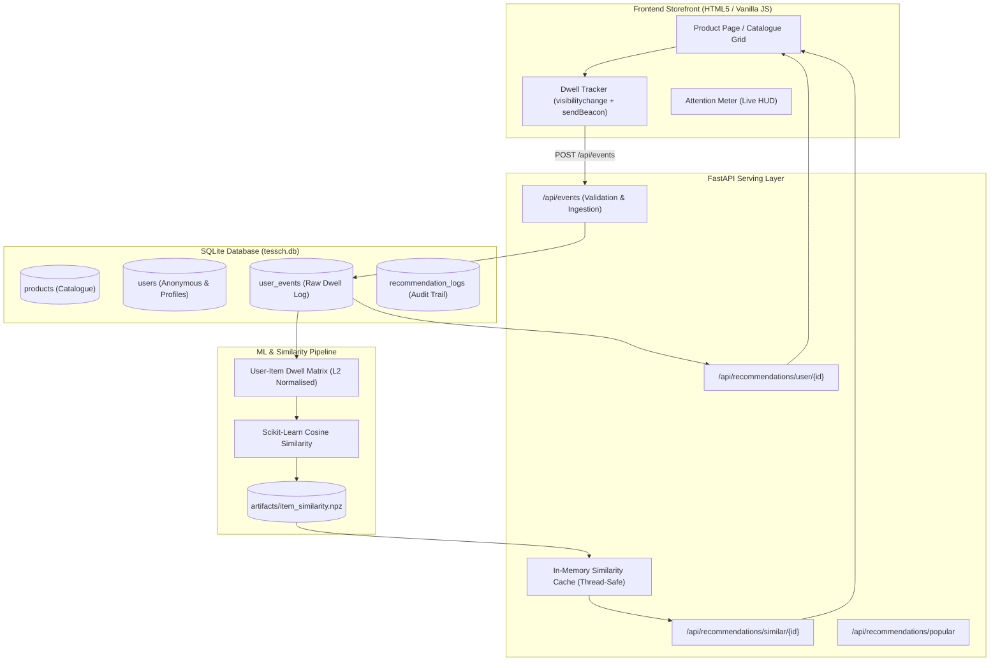

# TESSCH Recommendation Engine — Behavior-Based Recommender System

[](https://www.python.org/)
[](https://fastapi.tiangolo.com/)
[](https://scikit-learn.org/)
[](#6-run-the-test-suite)
[](https://opensource.org/licenses/MIT)

An end-to-end, privacy-preserving, behavior-based product recommendation engine built for **TESSCH's modular footwear brand**.

Rather than relying on intrusive rating prompts or forced account sign-ups, this system captures continuous implicit engagement—specifically **page dwell time** (how long a shopper genuinely looks at a product)—and translates that signal into two real-time recommendation surfaces:
1. **"Picked for you"** (`/api/recommendations/user/{user_id}`): Personalised recency-decayed product rankings reminding returning visitors what held their attention.
2. **"You might also like"** (`/api/recommendations/similar/{product_id}`): Cross-user collaborative item-to-item recommendations derived from cosine similarity computed over an L2-normalized user-item matrix.

---

## Live prototype

[Open the interactive TESSCH demo](https://yuvraj2637.github.io/tessch-recommendation-engine/).

Browse the 25 curated products, open a product for at least one second, then close it to see **Picked for you** update. **Try sample activity** loads an example session and **Reset activity** clears the browser's saved views. Product details show related items using cosine similarity on 1,286 synthetic views from 70 simulated shoppers, with a popularity fallback for products without enough data.

The GitHub Pages demo runs in the browser, and personal activity is stored locally. Serve it locally with `python -m http.server 8000 --directory docs`. To refresh its synthetic data after running the project's event generator, use `python -m scripts.export_pages_demo`.

---

## Architecture Overview



---

## Key Technical Decisions & Mathematical Foundations

### 1. Why Dwell Time over Clicks or Ratings?
- **Zero-Friction Implicit Feedback:** Casual e-commerce browsers rarely leave ratings or sign in. Dwell time provides continuous, graded preference signal ($t \in [1.0, 1800.0]$ seconds) rather than binary click/no-click events.
- **Client-Side Anti-Distortion Instrumentation:**
  - **Pauses on Hidden Tabs:** Uses `document.visibilitychange` so tabs opened in the background don't register false engagement.
  - **Reliable Beacon Dispatch:** Dispatches payloads using `navigator.sendBeacon` and `pagehide` to eliminate dropped unload requests on mobile/Safari.
  - **Bounds Filtering:** Discards sub-second views ($t < 1.0\text{s}$, treating them as mis-clicks/bounces) and clamps abandoned tabs ($t > 1800.0\text{s}$ capped at 30 minutes).

### 2. Phase 2: Personalised Attention Ranking with Time Decay
For visitor $u$, viewing time on product $i$ at event time $t_e$ decays exponentially with half-life $\lambda$ (default 30 days):

$$\text{Score}(u, i) = \sum_{e \in E_{u, i}} d_e \cdot 2^{-\frac{t_{\text{now}} - t_e}{\lambda}}$$

Where $d_e$ is the clamped dwell time in seconds. Products are ranked descending by score, with tie-breaking given to most recent views. First-time visitors automatically receive a popularity fallback.

### 3. Phase 3: Row Normalisation & Item-to-Item Cosine Similarity
Across $M$ users and $N$ products, the raw dwell matrix $R \in \mathbb{R}^{M \times N}$ is assembled ($R_{u,i} = \sum d_{u,i}$).

#### Why L2 Row Normalisation?
Because user engagement follows a power-law distribution (Gini ≈ 0.51), an unnormalised matrix allows a single heavy browser to dominate co-view dot products. Applying per-user Euclidean normalisation:

$$\hat{\mathbf{r}}_u = \frac{\mathbf{r}_u}{\|\mathbf{r}_u\|_2} = \frac{\mathbf{r}_u}{\sqrt{\sum_{j} R_{u, j}^2}}$$

Each user contributes equal total weight ($\|\hat{\mathbf{r}}_u\|_2 = 1$), isolating shared preference patterns from raw volume differences.

#### Cosine Similarity over Product Columns:
For two product columns $\mathbf{p}_i, \mathbf{p}_j \in \mathbb{R}^M$:

$$\text{Sim}(i, j) = \frac{\mathbf{p}_i^T \mathbf{p}_j}{\|\mathbf{p}_i\|_2 \|\mathbf{p}_j\|_2} \in [0, 1]$$

- **Direction over Magnitude:** Recognises two niche sneakers as similar if the *same cluster* of shoppers viewed them, even if one is viewed 10x less than a bestseller.
- **Structural Zeros Preserved:** Unlike Pearson correlation (which subtracts column means and invents artificial negative ratings for unviewed products), cosine similarity treats unobserved cells as genuine lack of evidence.

---

## Directory Structure

```text
tessch-recommendation-engine/
├── backend/
│   ├── api/
│   │   ├── app.py                 # FastAPI application, lifespan & static mounting
│   │   ├── deps.py                # Database connection and query parameter injection
│   │   ├── schemas.py             # Pydantic request/response schemas
│   │   └── routers/
│   │       ├── events.py          # Phase 1 tracking endpoint (/api/events)
│   │       ├── recommendations.py # Phase 2 & 3 recommendation endpoints
│   │       ├── products.py        # Catalogue querying endpoints
│   │       └── ops.py             # Health, provenance & cache diagnostics
│   ├── core/                      # Configuration, constants & scoring weights
│   ├── database/                  # SQLAlchemy models, SQLite raw queries & writes
│   └── services/                  # Ingestion validation & recommendation serving
├── recommendation/
│   ├── matrix.py                  # User-Item matrix construction & row normalisation
│   ├── similarity.py              # Item-Item Cosine Similarity (Scikit-learn + NumPy)
│   ├── personal.py                # Phase 2 user dwell ranking & time decay
│   ├── scoring.py                 # Multi-signal interest scoring
│   └── evaluate.py                # Coherence lift, Gini index & stability metrics
├── simulation/                    # Persona-based synthetic browsing generator
├── frontend/                      # Modular sneaker mock storefront (HTML5/CSS3/Vanilla JS)
├── notebooks/                     # Exploratory analysis & visual validation notebook
├── reports/                       # Generated data quality & similarity markdown reports
├── scripts/                       # CLI workflows (init_db, generate_events, build_similarity, devserver)
└── tests/                         # Pytest test suite covering schema, tracking, algorithms & API
```

---

## Quickstart & Reproducibility

### 1. Installation
```bash
# Clone the repository
git clone https://github.com/yuvraj2637/tessch-recommendation-engine.git
cd tessch-recommendation-engine

# Install dependencies
pip install -r requirements.txt
```

### 2. Initialize Database & Generate Synthetic Event Data
```bash
# Initialize SQLite tables (data/tessch.db)
python -m scripts.init_db --reset

# Simulate realistic browsing sessions (80 personas, 30 days history)
python -m scripts.generate_events
```

### 3. Build & Evaluate Similarity Model
```bash
# Fit item-item cosine similarity, save .npz artifact, and export evaluation report
python -m scripts.build_similarity --report --compare-normalisation
```

### 4. Run the Storefront & API Server
```bash
# Launch FastAPI backend with uvicorn
uvicorn backend.api.app:app --reload --port 8000

# (Or run the zero-dependency standard library server)
python -m scripts.devserver
```
Visit **`http://127.0.0.1:8000/`** to explore the mock storefront, watch the live attention meter, and test personalization. Interactive API documentation is available at **`http://127.0.0.1:8000/docs`**.

### 5. Simulate Live Multi-User Browsing over HTTP
```bash
# Open a second terminal and drive simulated shoppers with distinct tastes
python -m scripts.simulate_browsing --personas 3
```

### 6. Run the Test Suite
```bash
pytest -v tests
# Expected: 23 passed

# Alternative runner (no pytest install required):
python -m tests.run_tests
```

---

## Validation & Experimental Results

All numbers below are reproducible from the frozen dataset (`seed=20260825`, 80 users, 300 products, 11,285 events).
Run `python -m scripts.build_similarity --report --compare-normalisation` to regenerate.
Full output: [`reports/phase3_similarity.md`](reports/phase3_similarity.md) and [`reports/phase3_similarity.json`](reports/phase3_similarity.json).

### Category Coherence vs. Random Baseline
The recommender only sees anonymous user dwell time and has **zero access** to product metadata (category, style, color). Attribute coherence serves as an objective external validator:

| Attribute | Top-1 Match | Top-6 Match | Random Baseline | Lift over Chance |
| :--- | :---: | :---: | :---: | :---: |
| **Category** | **76.4%** | **72.6%** | 26.1% | **2.78x** |
| **Style** | **42.8%** | **44.1%** | 18.7% | **2.36x** |
| **Color Family** | 21.2% | 25.0% | 20.0% | 1.25x *(Control)* |

> **Sanity Control:** Color agreement sits essentially at random chance (1.25x). Because viewing behavior naturally clusters by footwear function rather than color, this is expected. A model with high lift on *every* attribute would indicate bestseller collapse, not genuine behavioral clustering.

### Normalisation Trade-Off Comparison

The key question is whether recommendations belong to the whole user population or to one heavy user. Removing the single most-active user and re-fitting exposes this:

| Row Scaling | Category Top-K | Lift | Jaccard Stability | Top-1 Unchanged |
| :--- | :---: | :---: | :---: | :---: |
| **None** (Raw seconds) | 77.0% | 2.95x | 0.819 | 84.8% |
| **L2 Normalisation** *(Chosen)* | 72.6% | **2.78x** | **0.940** | **92.2%** |
| **User Share** (L1) | 69.3% | 2.66x | 0.976 | 96.3% |

L2 was chosen on that trade: it gives up 4.4 points of category coherence to gain 12.1 points of stability, cutting the share of neighbour slots that change when one user leaves from 18.1% to 6.0%.

### Additional Dataset Statistics

| Metric | Value | Source |
| :--- | :---: | :--- |
| User activity Gini coefficient | **0.51** | `reports/stage1_stats.json` |
| Spearman(hidden affinity, observed engagement) ρ | **0.21** | `reports/stage1_stats.json` |
| Leave-one-out top-6 Jaccard stability | **0.940** | `reports/phase3_similarity.json` |
| Legacy recommender CTR (baseline to beat) | 16.8% | `reports/stage1_data_quality.md` |

---

## Resume-Verified Metrics

> Every metric below is directly reproducible from the code and frozen dataset. No numbers have been adjusted or hand-tuned.

| Resume Claim | Exact Value | Reproducing Command |
| :--- | :---: | :--- |
| Category lift over random chance | **2.78x** | `python -m scripts.build_similarity --report --compare-normalisation` → `reports/phase3_similarity.md` |
| Category Top-6 match rate | **72.6%** | Same |
| Category random baseline | **26.1%** | Same |
| Style lift | **2.36x** | Same |
| Color family lift (control, near-chance) | **1.25x** | Same |
| Jaccard stability (leave-one-out) | **0.940** | Same → `reports/phase3_similarity.json` |
| User activity Gini | **0.51** | `python -m scripts.generate_events` → `reports/stage1_stats.json` |
| Spearman ρ (affinity vs engagement) | **0.21** | Same → `reports/stage1_stats.json` |
| Test suite | **23/23 passed** | `pytest -v tests` |

---

## Limitations & Production Considerations

1. **Cold-Start Problem:**
   - *New Products:* A sneaker with zero views has an empty column in the user-item matrix. Handled gracefully by falling back to category/global popularity with explicit strategy headers (`strategy: "popular"`).
   - *New Visitors:* Visitors without `localStorage` dwell history receive popularity fallback until their first dwell event is recorded.
2. **Computational Complexity ($O(N^2)$):**
   - For a catalog of $N = 300$ items, exact cosine similarity computes in $<5\text{ms}$ and requires $<1\text{MB}$ memory.
   - For $N > 100,000$, the architecture would transition to Approximate Nearest Neighbors (ANN) via FAISS / HNSW index partitions.
3. **Exposure Bias:**
   - Products displayed prominently on the homepage accumulate more dwell time. The system records `surface` and `position` metadata for every event to enable inverse propensity scoring in future iterations.
4. **Synthetic Training Data:**
   - The similarity model is trained on simulator-generated browsing sessions (80 persona archetypes, `seed=20260825`). Real production data would replace this; all metrics are reported against this synthetic dataset.

---

## Resume Bullets & Interview Talking Points

- **Built an end-to-end e-commerce recommendation system** for modular footwear using **FastAPI**, **SQLite**, **Pandas**, and **Scikit-learn**, leveraging client-side dwell time tracking (`sendBeacon`, `visibilitychange`) to capture non-intrusive implicit preference signals.
- **Implemented dual recommendation surfaces**: a personalized recency-decayed dwell ranker ("Picked for you") and a cross-user collaborative item-to-item recommender ("You might also like") using column-wise **Cosine Similarity** over an **L2-normalized** user-item matrix.
- **Evaluated algorithmic coherence**: achieved **2.78x lift** in category agreement over random chance baselines while maintaining high robustness against power-user skew (leave-one-out Jaccard stability 0.940, Gini ≈ 0.51).
- **Engineered an observable mock storefront** with interactive HUD instrumentation, session persona simulator, automated test coverage (`pytest`, 23/23 passing), and reproducible data pipelines.
